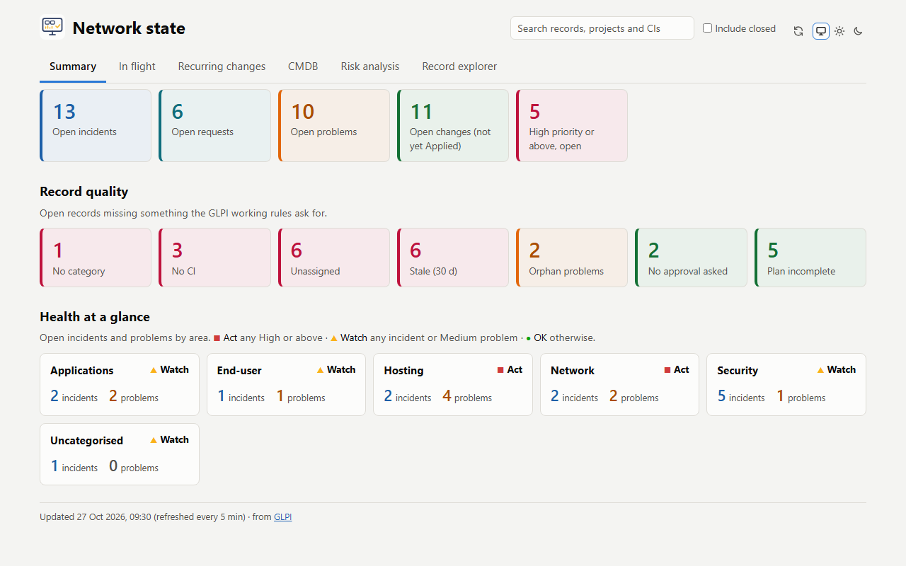
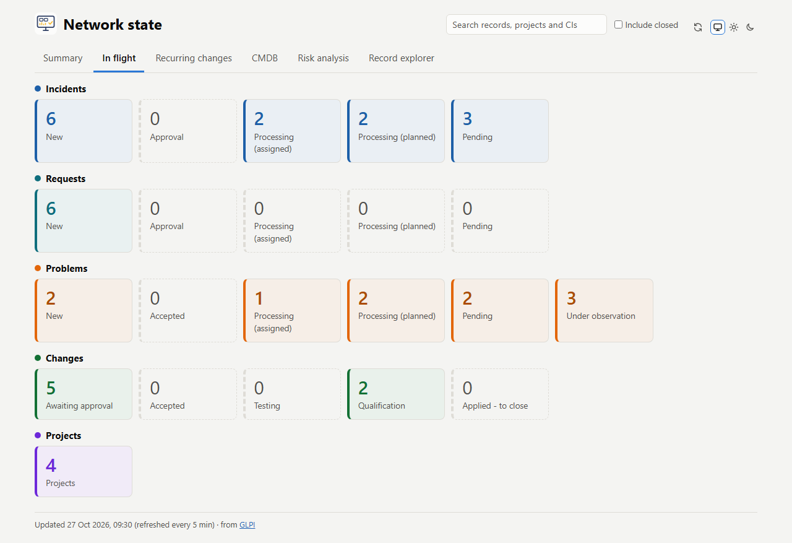
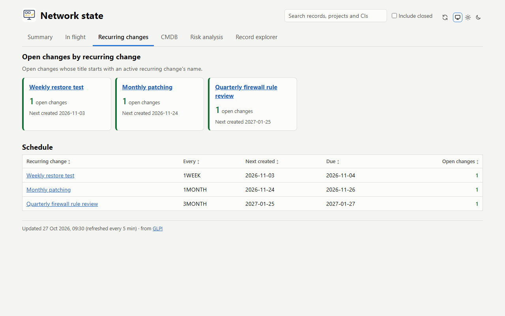
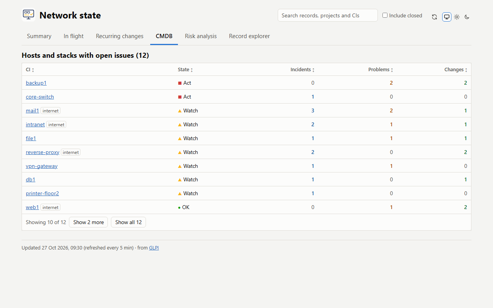
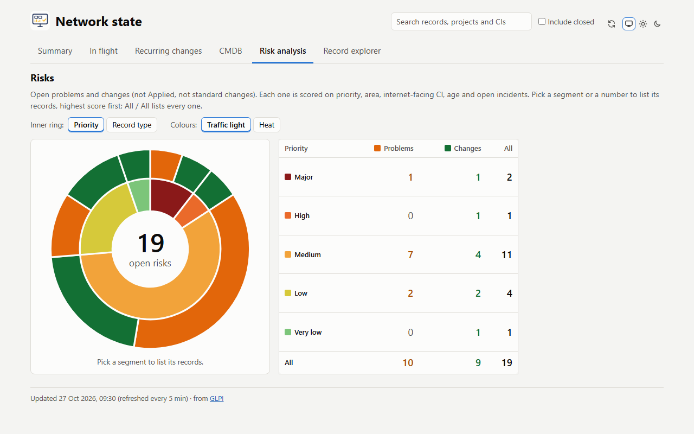
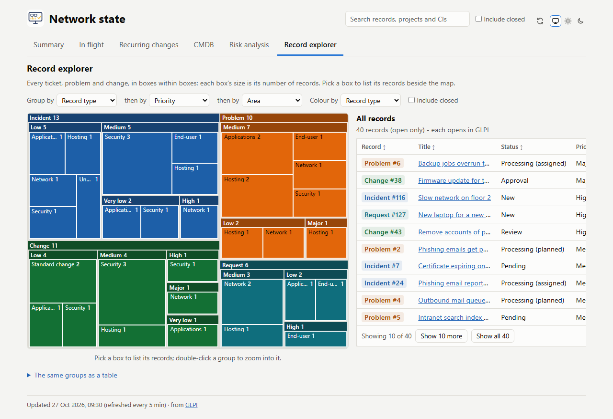
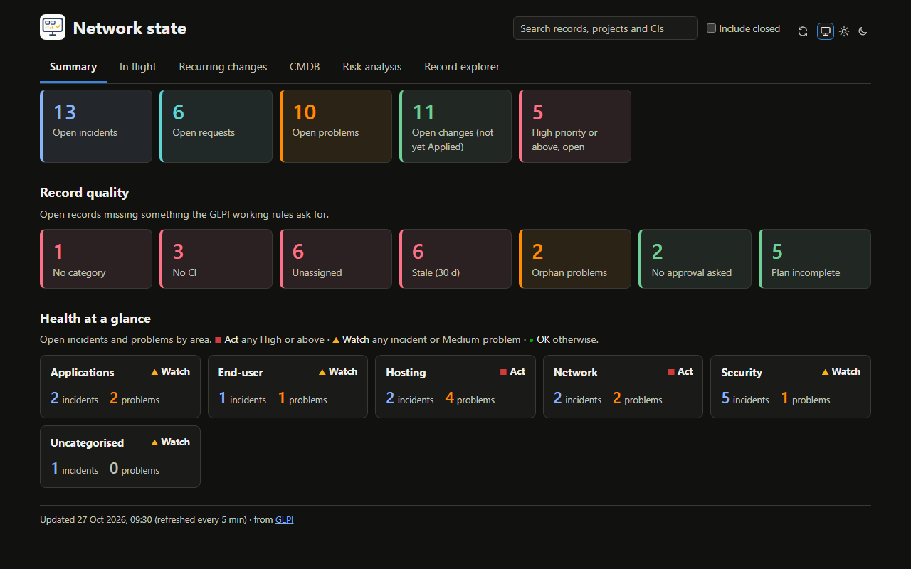
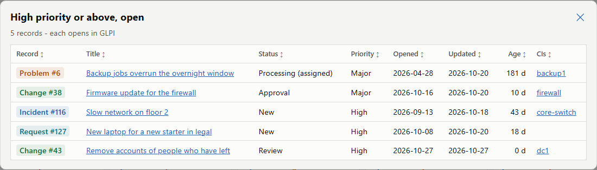
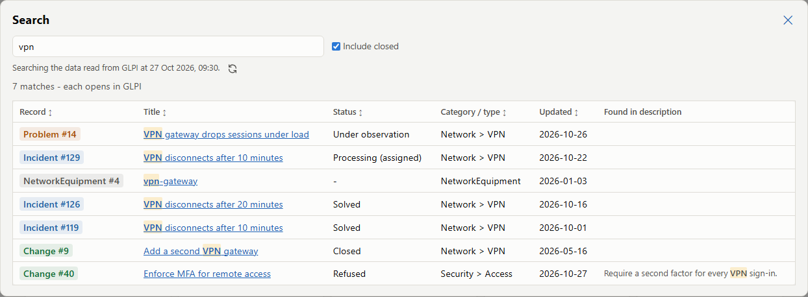

# GLPI Dashboard

A read-only web page showing the state of your IT service management in [GLPI](https://glpi-project.org/):
what's open, what's at risk, and what's in flight. GLPI is the only source. Monitoring tools that feed GLPI
(through their own integrations) stay the place for real-time data.

This project is my own view of my estate, built around how I work. The layout is fixed, but it builds itself from
what's in your GLPI (areas from your ITIL categories, CIs from your links and impact graph), and the parts that
depend on one site's set-up are [settings](#configuration): the title, locale, time zone, which areas weigh more
in the risk ranking, your standard-change category and when a record counts as stale. With good categorisation
and prioritisation it gives another view of your GLPI instance. For anything deeper, forking it is the way.

The screenshots below come from a generated demo dataset, not a real GLPI.

## What it shows

The page has six tabs. The browser remembers the last one you chose.

- **Summary**: open incidents, requests, problems and changes, and High-priority records.
  - **Record quality**: open records missing something the GLPI working rules ask for. That's no category;
    no CI (incidents, problems and changes only, since requests often have none); no technician or group
    assigned; no update in 30 days (`STALE_DAYS`); problems linked to no incident and no change; and, for
    changes other than standard changes, still in New with no approval requested, or an empty Impacts,
    Deployment plan, Backup plan or Checklist. Each tile has a short label; hover or focus it for half a
    second to see the full rule, and press Escape to hide it.
  - **Health at a glance**: open incidents and problems per area, rated red/amber/green. An area is a top-level
    ITIL category: `Security > Certificates` counts towards `Security`, so arrange your categories with the
    areas you want at the top. Every top-level category shows, apart from the standard-change one. Red means any High or above. Amber means any incident or Medium problem. Anything
    else is green. The state is always shown as an icon and a word, not colour alone.

  

- **In flight**: open incidents, requests and problems by status; changes awaiting approval, at
  Accepted/Testing/Qualification, or Applied but not closed; and a Projects tile that lists each project
  with its progress and linked records.

  

- **Recurring changes**: the open changes made by each active recurring change (e.g. monthly patching), and
  the schedule (next creation and due dates). GLPI doesn't link a change back to the recurring change that
  created it, so a change counts if its title starts with the recurring change's name (ignoring case; the
  longest matching name wins).

  

- **CMDB**: the hosts and stacks (CIs) with open incidents or problems, rated like the areas.

  

- **Risk analysis**: open problems and changes (not Applied, not standard changes), as a two-ring chart
  beside a table of the same counts. The inner ring splits them by priority, and the outer ring splits each
  priority into problems and changes. **Record type** swaps the rings. **Colours** picks how priority is
  shown: *Traffic light* (green for Very low through to red for Major) or *Heat* (one red, deeper for higher
  priority). The browser remembers both choices. Each segment and each number in the table opens its
  records, ranked by a score made of priority, area (`RISK_AREAS`: Security +15 by default), an internet-facing
  CI, age and open incidents on a problem; the table's All / All opens every one. The other weights are `RISK_*`
  in `app/model.py`, and the "Why" column shows each record's breakdown, so they're easy to tune (see
  [Tuning the risk ranking](#tuning-the-risk-ranking)). The table names every priority, so
  colour is never the only cue: six traffic-light steps can't all stay distinct for colour-blind readers.

  

- **Record explorer**: every ticket, problem and change as a treemap, boxes within boxes in the manner of
  WinDirStat, each box sized by its number of records. **Group by** and up to two **then by**s pick the
  nesting from record type, priority, area, category, status, open or closed, assigned or not, has a CI or
  not, **Linked CI** (a box per CI; a record linked to several is in each of their boxes, which the page
  notes), **Linked records** (a family of records joined by problem-incident and change-problem links, named
  after its problem, or its change if it has none), when it was opened (last week, month, 3 months, year, or
  longer ago) and the year it was opened. A grouping used above can't be picked again, and *(nothing)* ends
  the nesting there. **Colour by** picks record type, priority or open/closed (or nothing), and splits the
  innermost boxes by it when it isn't already a grouping, so every smallest box has one colour. Boxes are
  filled with the full colour, each group's name is a darker (or, in the dark theme, lighter) band along
  its top, and the text on each is black or white, whichever reads better. **Include closed** adds closed
  records. The tab widens to 90% of a wide window, more than the others. Pick any box to list its records
  beside the map (below it on a narrow screen), each opening in
  GLPI, with long titles cut short (hover for the whole title); **Zoom in**, or a double-click on a group, fills the map with
  that group, and the path above the map zooms back out. The view, and the box picked, are in the address
  (`#explore=...`), so it can be shared, and Back steps back through the boxes picked; the browser remembers
  the groupings and colour. *The same groups as a table* below the map holds every group and count as text,
  for anyone not using the map. Every box has a name for screen readers and works from the keyboard.

  

Each kind of record has its own colour, used the same way everywhere: incidents blue, requests teal, problems
orange, changes green and projects violet. Tiles that flag an issue across kinds (High priority, and record
quality checks such as No CI) are red; one that is about a single kind (e.g. Orphan problems) keeps that
kind's colour. It shows as a tile's light tint,
edge and number, a dot by each In flight group, a tinted reference chip in every list, and the incident, problem and
change counts on area cards and in the CMDB table. The kind is always written out too, so colour is never
the only cue, and every colour meets WCAG AA contrast in both light and dark themes. A tile with nothing in
it is dimmed: no fill, a dashed grey border and a grey number.

**Light and dark themes.** The page follows your system's colour scheme by default. The three buttons at the top
right, beside Refresh now, pick System, Light or Dark, and the browser remembers the choice (if it can't store
it, the page stays on System).



**Every number is a link** (`#list=<key>`) to the list behind it, each entry opening in GLPI. The number is
computed as the length of that list, so the two can't disagree. (The Record explorer's boxes are grouped in the
page, each from the same records it lists, so they can't disagree either.) Lists can be bookmarked. Record lists show
when each record was opened and last updated.



Every table sorts by any column: click a header, and click again to reverse. Tables show 10 rows, with
**Show more** and **Show all** below, and **Show less** to go back to 10. Escape, ✕ or a click outside a list closes it.

**Search**: the box at the top right, beside Refresh now, searches the open tickets, problems and changes,
the projects and the CIs the dashboard read. Tick **Include closed** to search closed records too. It's off by
default, which also keeps searches quicker. Pause typing for half a second, or press Enter, and the results open over
the page. They have their own search box (✕ clears it) and Include closed, to refine them, and say which refresh
they search. Their **Refresh now** button re-reads GLPI and searches again. A result must contain every word typed
(ignoring case), in its title, description, category, status, reference or linked CI names, or for a CI its
serial, inventory number or comment. An exact `#id` comes first, then title matches, then everything but closed
records, most recently updated first. Words found only in the description are shown in context. Up to 100
results are listed, with the total. Searches can be bookmarked (`#search=<words>`, plus `&closed=1`). Only CIs of
the types linked to a record (or in the impact graph) are searched, since those are the ones the dashboard reads.
Followups, tasks and solutions aren't searched: reading them would cost GLPI many more requests. Search shows
description text, which the rest of the page doesn't, so anyone who can open the dashboard can read the
descriptions.



"Internet-facing" comes from GLPI's impact graph: the CIs impacted by `INTERNET_FACING_ROOTS` (typically your
reverse proxy), plus the CIs named in `INTERNET_FACING_EXTRA` (e.g. the firewall).

## How it works

`app/main.py` (FastAPI) refreshes a snapshot from GLPI every `REFRESH_SECONDS` (300) in the background. It
serves the snapshot at `/api/snapshot`, along with the static page (`app/static/`, no build step).
Each refresh also keeps a search index in memory, and `/api/search?q=<words>` (with `&closed=true` for closed records too) searches that, so a search
makes no GLPI requests and shows the data as of the last refresh. It also keeps every record, closed ones too,
for the Record explorer at `/api/explorer`; the page asks for that only while the explorer shows, once per refresh.

- **If GLPI is unreachable**, the last snapshot stays, with a banner.
- **`/healthz`** fails once the data is three refreshes old.
- **Refresh now** (the circular-arrows button at the top right; `POST /api/refresh`)
  re-reads GLPI at once, at most every 30 s
  (`MANUAL_MIN_SECONDS`). A click during a running refresh waits for it.
- **When the data was last read**, and how often it's refreshed, is in the page footer, with a link to GLPI.

It uses the **GLPI v1 API only** (`app/glpi.py`), because v2 has no endpoints for the links between records
and CIs or projects. A refresh makes about 30 calls.

## GLPI setup

- **A user, e.g. `dashboard`, on the Standard interface.** The Simplified interface hides most rights. Give
  it a read-only profile with these rights:
  - see all tickets, problems and changes (including who and which group they're assigned to), recurring
    changes and projects;
  - assets (computers, network devices, appliances, clusters, peripherals);
  - dropdowns (ITIL categories, project states);
  - impact analysis.

  Don't give it approval rights. GLPI only shows approval requests to profiles that may create or approve
  them, so "awaiting approval" uses each change's own `global_validation`.
- **That user's API token**, from Remote access keys in the user's settings.
- A missing right shows in the container log as `dashboard profile cannot read: <types>
  (ERROR_RIGHT_MISSING)`.
- **An API client, e.g. `dashboard`** (Setup > General > API): active, with its **app token**. Its IPv4
  range must cover the address GLPI sees for this container, which is usually the Docker network's subnet
  when both run on the same Docker network.

## Configuration

Copy `.env.example` to `.env` and fill it in. Keep `.env` readable only by admins; it holds both tokens.

| Variable | Meaning |
|---|---|
| `GLPI_URL` | GLPI as the container reaches it, e.g. `http://glpi` on a shared Docker network |
| `GLPI_PUBLIC_URL` | GLPI as a browser reaches it; every link on the page points here |
| `GLPI_APP_TOKEN` | The API client's app token |
| `GLPI_USER_TOKEN` | The read-only user's API token |
| `REFRESH_SECONDS` | How often to re-read GLPI (default 300) |
| `INTERNET_FACING_ROOTS` | Comma-separated CI names whose impacted CIs are internet-facing (default none) |
| `INTERNET_FACING_EXTRA` | Further comma-separated CI names that are internet-facing (default none) |

These are optional, for fitting the page to your GLPI. A value that doesn't parse logs a warning and keeps the
default, so a typo never stops the dashboard. Area names must match a top-level ITIL category exactly, case
included; each refresh logs a warning naming any that match none.

| Variable | Meaning |
|---|---|
| `DASHBOARD_TITLE` | The page title and heading (default `Network state`) |
| `LOCALE` | Language tag for dates, times and sorting on the page, e.g. `en-US` (default `en-GB`) |
| `GLPI_TZ` | GLPI's time zone, so ages and dates match GLPI's (default `Europe/London`). `compose.yml` hands it to the container as `TZ`; it's named apart so a `TZ` set in your shell can't override it |
| `RISK_AREAS` | Extra risk points per area, as comma-separated `Area:points` (default `Security:15`; empty for none). GLPI has nowhere to keep a weight on a category, so it's set here |
| `STANDARD_CHANGE_AREA` | The top-level category of pre-approved changes, left out of the risks, the areas and the change checks (default `Standard change`; empty for none) |
| `STALE_DAYS` | Days without an update before an open record counts as stale (default 30) |

### Tuning the risk ranking

A record's risk score is its points added up:

| Part | Points |
|---|---|
| Priority | Very low 0, Low 10, Medium 25, High 45, Very high 70, Major 90 |
| Area (`RISK_AREAS`) | Security 15 by default, or whatever you set |
| An internet-facing CI | 15 |
| Age | 0 to 15, rising over 180 days |
| Open incidents linked to a problem | 5 each, up to 15 |

No area bonus is right in itself. What matters is where it lands against the gaps between priorities (10, 15, 20,
25 and 20 points), so decide whether a record in that area should jump a priority level or only rank higher
within its own:

- **Up to about 15** mostly reorders records within a priority. A Medium Security problem (25 + 15 = 40) stays
  below a plain High (45), but beats every other Medium.
- **20 or more** lets the area jump a level: Medium plus 20 ties with a plain High.
- **Over 35**, a Low record in the area (10 + 36 = 46) beats a plain High, so the area outweighs priority.

To choose, name one pair of records you have a view on, e.g. "a Medium security issue on an internet-facing host
should beat an ordinary High". That's 25 + 15 + bonus > 45, so the bonus must be over 5. Set it, restart the
container, and check the Risk analysis ranking: the **Why** column shows each record's points. Keep several areas'
bonuses in proportion to each other, or the ranking stops following priority. The other weights are `RISK_*` in
`app/model.py`.

## Running

The image is published to GHCR as `ghcr.io/sjefferson99/glpi-dashboard`. Put `compose.yml` and your `.env`
in one folder, then:

```bash
docker compose pull && docker compose up -d
docker compose ps                    # expect (healthy)
docker compose logs | grep -E "refreshed|failed|cannot read|unavailable"   # expect "refreshed: N records"
```

To upgrade, run the same `pull && up -d`.

| Tag | Built from |
|---|---|
| `latest` | The latest commit on `main`, or the latest release |
| `X.Y.Z`, `X.Y` | A release tag `vX.Y.Z` |
| `sha-<commit>` | One exact commit |

Pin `X.Y.Z` or `sha-*` in `compose.yml` to control when upgrades happen.

To build from a checkout instead: `docker compose -f compose.yml -f compose.dev.yml up -d --build`.

The image uses a pinned `python:*-slim` base and pinned `requirements.txt`, and runs `apt-get upgrade` for
Debian fixes. CI (`.github/workflows/container.yml`) runs both test suites before building. A PR only
builds the image; a push to `main` or a `v*.*.*` tag publishes it. The container runs read-only as UID
10001 with all capabilities dropped. It holds no data to back up.

**The page shows internal GLPI data and has no login of its own.** `compose.yml` publishes it on localhost
only. To serve it more widely, put it behind a reverse proxy that authenticates users. `compose.yml` has a
commented Traefik example. Leave `/healthz` unauthenticated if a monitor needs it: it answers only ok and a
time.

**Monitoring:** an HTTP monitor on `/healthz` turns red when GLPI can't be read for three refreshes.

## Tests

The tests need no GLPI and no Docker.

- **`tests/`** (pytest) drives the real GLPI client and app against a fake GLPI v1 API
  (`tests/fake_glpi.py`).
- **`ui-tests/`** runs Playwright in headless Chromium against the app served by uvicorn, with the same
  fake.

```powershell
uv venv --python 3.14 .venv
uv pip install -r requirements.txt -r requirements-dev.txt
.venv\Scripts\python.exe -m playwright install chromium
.venv\Scripts\python.exe -m pytest            # unit + API
.venv\Scripts\python.exe -m pytest ui-tests   # browser
```

To try the page without a GLPI, `scripts/demo.py` serves it at `http://127.0.0.1:8001` on a generated demo
dataset (`tests/demo_glpi.py`: about 200 records from a fixed seed, all generic names). The screenshots above come
from it; `scripts/demo.py shot --help` takes one.

```powershell
.venv\Scripts\python.exe scripts/demo.py
```
